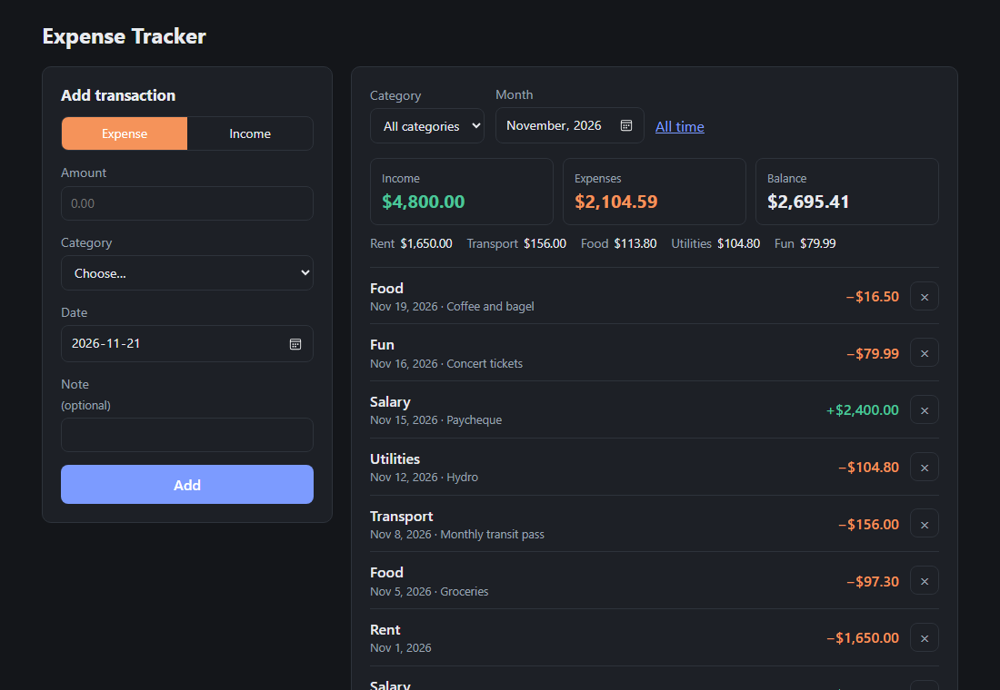
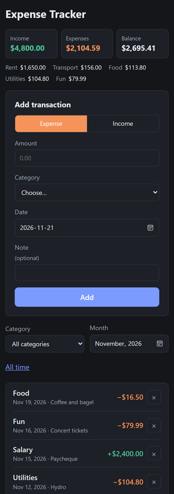

# Expense Tracker

Log income and expenses by category, see totals for a month or all time, and delete entries. Amounts are in Canadian dollars.

**Live:** https://expense-tracker-07et.onrender.com/

> Runs on Render's free tier. After about 15 minutes without visitors it goes to sleep, so the first visit can take up to a minute. Its disk is wiped on every restart, so anything you add disappears and your browser quietly starts a fresh list with the samples.

<p>
  
  
</p>

Project 1 of a full-stack practice series.

## Features

- Add an income or expense with an amount, category, date and optional note.
- Filter by category and month, or view all time.
- Income, expense and balance totals, with an expense breakdown by category.
- Delete with an inline "Delete? Yes / No" confirm.
- One private list per browser, with no accounts, started with three sample rows.
- Empty states that name the active filters.
- Works on a phone: totals, form, filters, then the list.
- Light and dark themes follow the system setting.

## Stack

| Part | Tools |
| ---- | ----- |
| Client | React 19, Vite, oxlint |
| Server | Node, Express 5, Zod 4, `helmet`, `express-rate-limit` |
| Database | SQLite through `better-sqlite3`, plain parameterized SQL |
| Tests | Vitest and Supertest, each test on its own in-memory SQLite database, run in GitHub Actions on every push |
| Hosting | Render free web service; Express serves the built client |

Money is stored as integer cents, so totals never pick up floating-point errors.

## API

Every route except `POST /api/owners` and `GET /api/categories` needs the `X-Owner-Key` header, and only ever sees that owner's rows.

| Method | Route | Does |
| ------ | ----- | ---- |
| `POST` | `/api/owners` | Make an owner with the three sample rows; returns `201` with `{ key }` |
| `GET` | `/api/categories` | The category list |
| `GET` | `/api/transactions?category=&month=YYYY-MM` | Transactions, newest first, both filters optional |
| `POST` | `/api/transactions` | Add one; returns `201`, or `400` with the fields that failed |
| `DELETE` | `/api/transactions/:id` | Delete one; `204`, or `404` if it does not exist or belongs to someone else |
| `GET` | `/api/summary?month=YYYY-MM` | Income, expense and balance totals, plus per-category totals |

Errors are JSON, `{ error }`, plus `issues: [{ field, message }]` on a `400`. A missing or unknown key is `401`; an owner at 1,000 transactions gets `422`; more than 10 new owners an hour from one address get `429`; a body over 10 kB gets `413`.

## Security

- **Each browser has its own list.** The browser keeps a random key (a UUID) in `localStorage` and sends it with every request. Every query names the owner, so another owner's id answers `404`, exactly like one that does not exist. Owners unseen for 30 days are removed with their rows. The key works like a password for that list: anyone who has it can use the list, and there are no accounts.
- **Security headers** from `helmet` on every answer. The Content-Security-Policy lets scripts, styles, images and requests come only from this site.
- **Limits:** 10 new owners per hour per address, 1,000 transactions per owner, 10 kB per request body.
- **Input** is checked with Zod before any SQL runs, unknown fields are refused, and every query uses placeholders, never pasted text.

## Run it locally

Needs Node 22 or later (the repo pins 26 in `.node-version`).

```bash
git clone https://github.com/Sanbogukai/expense-tracker.git
cd expense-tracker
cd server && npm install && cd ..
cd client && npm install && cd ..
```

Then in two terminals:

```bash
cd server && npm run dev    # API on http://localhost:3000
```

```bash
cd client && npm run dev    # app on http://localhost:5173
```

The first visit makes an owner for your browser with three sample rows. The database file is `server/expenses.db`; set `DB_PATH` to use another file. An older file from before owners existed keeps its shared rows in a `transactions_before_owners` table, untouched.

### Production build

```bash
cd client && npm run build && cd ../server && npm start
```

Express then serves the app and the API together on `PORT` (default 3000).

## Tests

```bash
cd server && npm test
```

23 tests, each on a fresh in-memory database with a fixed clock. They cover new owners and their samples, the key check, the owner limit (`429`), the 30-day clean-up, adding, filtering, the cap (`422`), deleting, that one owner can never see, delete or change the totals of another's rows, the security headers, oversized (`413`) and malformed bodies, and unknown routes. GitHub Actions runs them, plus the client's lint and build, on every push.
